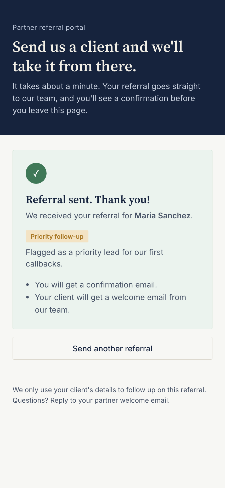
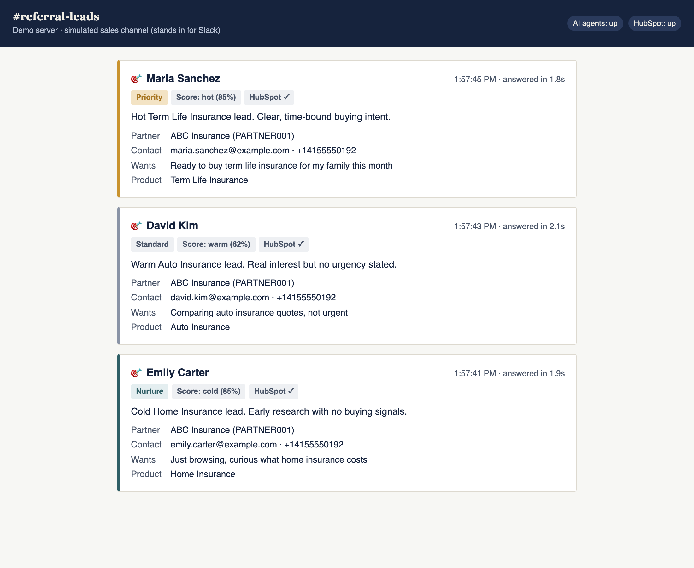
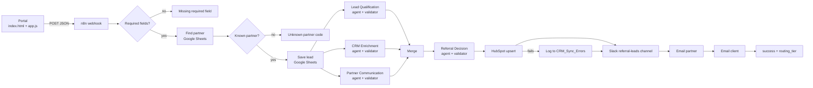

# Referral Partner Portal

[](https://github.com/StephLaine/referral-partner-portal/actions/workflows/test.yml)

**Live:** https://referral-partner-portal-smoky.vercel.app

A one-page form where insurance referral partners send a client to the sales team. Behind it, an n8n workflow with four AI agents ranks the referral, files it in HubSpot, alerts sales in Slack and emails both the partner and the client. The partner sees a confirmation with a follow-up tier in seconds.

> One form. Four AI agents. Every referral answered. None lost, even when the AI fails.

## The problem

Insurance agencies get much of their best business from referral partners such as other agents, brokers, realtors and accountants. Those referrals arrive however the partner likes: a text, an email, a phone call. Three things go wrong:

1. **The partner never hears back.** After a few clients disappear into silence, they stop referring.
2. **Sales can't tell who to call first.** A client ready to buy this month waits in line behind one who is just curious.
3. **Details get lost between tools.** Each referral is retyped from inbox to spreadsheet to CRM to team chat, and every retype can drop a phone number.

## What it does

- **For the partner:** one short form, plain-language errors and a confirmation before they leave the page. The confirmation shows whether the client is a priority, a standard follow-up or a nurture lead.
- **For sales:** a Slack message with the lead already scored hot, warm or cold. It names the product to pitch and gives a one-sentence reason.
- **For the client:** a welcome email that mentions the partner who referred them.
- **For the business:** every referral is logged to a Google Sheet and upserted into HubSpot. If the AI or HubSpot fails, the referral still goes through and the failure is logged.

| The partner sends | Sales sees it ranked |
|---|---|
|  |  |

More states: [the form](demo/screenshots/1-form.png), [validation errors](demo/screenshots/2-validation.png), [sending](demo/screenshots/3-sending.png), [nurture tier](demo/screenshots/5-success-nurture.png), [unknown partner code](demo/screenshots/6-unknown-partner.png) and [server error](demo/screenshots/7-server-error.png).

## Architecture



Every AI agent is followed by a validator. It strips stray formatting, parses the JSON, checks the required key and, if anything fails, substitutes a safe default so the run continues. The default routes the lead to the standard tier and asks sales to review it by hand. [HANDOFF.md](HANDOFF.md) goes node by node.

## How to run it

**Try it with no accounts.** You need Node.js 20 or newer, and there is nothing to install.

```bash
npm run demo
```

Open `http://localhost:8787` for the portal and `http://localhost:8787/feed` for a stand-in for the sales Slack channel. Use partner code `PARTNER001`. The demo server answers exactly like the real workflow, but its agents are **simulated with keyword rules, not Claude**. Press `a` in its terminal to simulate an AI outage, `h` for a HubSpot outage, or `x` to crash the next run.

**Run the tests.** [TESTING.md](TESTING.md) has the full test report, coverage and how each layer works.

```bash
npm test               # 111 unit and browser tests, no dependencies (browser tests need Chrome)
npm run test:n8n       # 10 integration tests: the real workflow on n8n 2.43.8 (npm install -g n8n@2.43.8 first)
npm run coverage       # writes coverage/REPORT.md
npm run mutation       # plants 15 known bugs and checks the tests catch each one
```

In CI, GitHub Actions runs all of the above on every push and pull request, including n8n in Docker. See [.github/workflows/test.yml](.github/workflows/test.yml). With an `ANTHROPIC_API_KEY` repository secret, a second job runs the integration test against the real Claude API.

| Measure | Latest |
|---|---|
| Critical-path line coverage | 100% |
| Workflow branches exercised on real n8n | 17 of 17 |
| Planted bugs caught | 15 of 15 |

**Connect the real workflow.** Import [n8n/referral-partner-program.json](n8n/referral-partner-program.json) into n8n, connect the credentials and activate it. Then put its production webhook URL in [config.js](config.js). [HANDOFF.md](HANDOFF.md) has the full setup, including the Anthropic credential and the HubSpot properties.

**Deploy.** Vercel deploys the `main` branch automatically. [.vercelignore](.vercelignore) keeps the published site to `index.html`, `app.js` and `config.js`.

## Known limitations

- **The live form depends on the n8n instance.** If the instance is off, partners see "We couldn't reach the server" and nothing is saved. As of October 20, 2026 the n8n Cloud instance answers "No instance here".
- **Anyone with the link can submit.** A hidden field stops simple bots, not a determined person. Rate limiting belongs in front of the webhook.
- **Partner codes are only checked inside n8n.** The form can't tell a code is wrong until the workflow answers.
- **n8n runs the three specialist agents one after another, not in parallel.** Response time has not been measured on the live system.
- **HubSpot merges contacts by email.** Test referrals that reuse one address update one contact.
- **The consent checkbox is sent but not stored.** The workflow ignores the `consent` field.
- **The demo server's agents are rules.** They show the flow and the failure handling, not Claude's judgment.
- **The live-Claude test hasn't run yet.** It needs an `ANTHROPIC_API_KEY` secret. Every other test runs on each push.

## Next steps

1. **Restore the n8n instance** and measure real response time, so the promise to partners is a number.
2. **Store consent.** Add the `consent` field and its timestamp to the Leads sheet and to HubSpot.
3. **Build a partner status page.** It would list every client a partner has sent and where each one stands.
4. **Rate-limit the webhook** and check partner codes before the AI runs, to keep costs predictable.
5. **Speed up the agents.** Run the three specialist agents in parallel with n8n sub-workflows.
